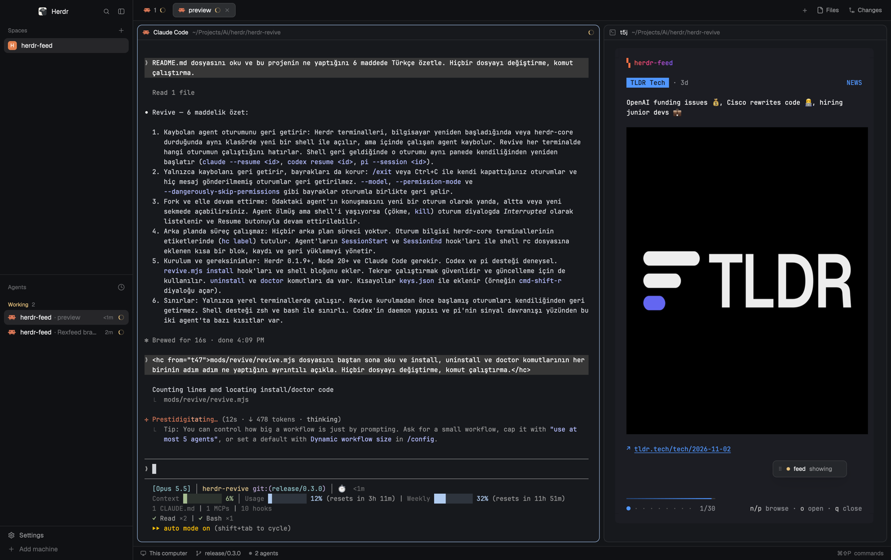

<div align="center">
  


  *Something worth a glance while your coding agent works, in a side pane of the [Herdr](https://herdr.dev) desktop app. For every agent Herdr recognizes.*

  [](https://github.com/dmazlum/herdr-feed/actions/workflows/ci.yml)
  [](https://github.com/dmazlum/herdr-feed/releases)
  
  [](LICENSE)

  [How it works](#how-it-works) • [Install](#install) • [Usage](#usage) • [Sources](#sources) • [Video](#how-video-works) • [Config](#config) • [FAQ](#faq)
</div>

<p align="center"></p>

While your agent thinks, you wait. herdr-feed fills that wait: a pane opens beside the agent and
rotates short tech cards (news, tips, product launches, YouTube and Reddit videos). Images and
videos play right in the pane through the kitty graphics protocol. When the agent stops, the pane
goes away, so your attention goes back to the agent.

> [!NOTE]
> herdr-feed builds on [rexfeed](https://github.com/alpcanaydin/rexfeed) by Alpcan Aydın, made
> for Rex: the sources, cache and card renderer come from it, and a Herdr mod drives the pane. It is an unofficial add-on, not made by or affiliated with Herdr, and
> uses the app's own mod API and herdr-core.

## How it works

A small Herdr mod watches the agents Herdr already tracks, so there are no per-agent hooks to
install: Claude Code, Codex, OpenCode, Pi and every other agent Herdr recognizes work the same way.

`cmd-shift-e` puts a small switch window on screen (`⠿ ● feed on`). While it is open:

| Event | Pane |
|---|---|
| The focused agent starts working | Opens in a split to its right, at 38% of the width; your focus stays on the agent |
| You click into the feed, or switch to another tab | Pauses |
| The agent goes idle, done or blocked | Closes |
| You move to another agent | Closes, and opens beside that one if it is working |
| `q` in the feed, or no unseen cards left | Stays closed until that agent's next turn |
| 30 cards shown | Loads the next batch of unseen cards |
| Switch clicked, or `cmd-alt-e` | Turns the feed off (and on again) |

Each batch goes video, image card, text card, round-robin across sources, so one feed doesn't take
over, and a card you've seen doesn't come back. When the cache is older than `refresh_minutes`,
opening the feed starts a fetch in the background.

## Install

You need a Mac with Apple silicon, the [Herdr desktop app](https://herdr.dev), a coding agent,
[Rust](https://rustup.rs) and Python 3 (the installer merges the app's `keys.json` with it).
For images and videos: `ffmpeg` and `yt-dlp` (`brew install ffmpeg yt-dlp`).

In Herdr, ask your agent to add `github.com/dmazlum/herdr-feed`: it reads
[`RECIPE.md`](RECIPE.md) and every file, builds the program, copies `mods/herdr-feed`, merges
[`keys.json`](keys.json) and checks the mod. Or by hand, from a checkout:

```sh
git clone https://github.com/dmazlum/herdr-feed && cd herdr-feed
./install.sh
```

From a release: download `herdr-feed-<version>-aarch64-apple-darwin.tar.gz` from
[Releases](https://github.com/dmazlum/herdr-feed/releases), unpack it and run `./install.sh` inside.
Keep the folder where it is: `~/.local/bin/herdr-feed` links to the binary in it.

<details>
<summary>What the installer does</summary>

- Builds the binary (from a checkout) and links `~/.local/bin/herdr-feed` to it.
- Tells you if `ffmpeg` or `yt-dlp` is missing.
- Runs `scripts/install-mod.sh`, which copies `mods/herdr-feed` into the app's mods folder
  (`~/.config/herdr-app/mods`, or `HERDR_APP_HOME`), adds `cmd-shift-e` and `cmd-alt-e` to its
  `keys.json` (backed up to `keys.json.bak-herdr-feed` first; a key already bound to something
  else is left alone) and checks the mod with `herdr-app check`. Running it again changes nothing.
- Runs a first `herdr-feed fetch`.
</details>

Then press `cmd-shift-e` in Herdr. The switch window remembers where you drop it and comes back
on the next start until you close it.

## Usage

Send prompts as usual. In the feed:

| Keys | What |
|---|---|
| `n` `→` `↓` `l` `j` | Next card |
| `p` `←` `↑` `h` `k` | Previous card |
| `space` | Pause / resume |
| `o` / `enter` | Open the link in your browser |
| `q` / `esc` / `ctrl+c` | Close the pane |

The bottom row spells these out as far as the pane's width allows. The link line is also an OSC 8
hyperlink, so `⌘`-click opens it too.

```
herdr-feed fetch                      refresh the cache (~/.cache/herdr-feed)
herdr-feed ready                      exit 0 when there are unseen cards
herdr-feed pane [--key KEY] [--driven]
                                      run the pane by hand (any kitty-graphics terminal)
herdr-feed state KEY running|paused|closed
                                      drive an open pane (the mod calls this)
herdr-feed resize AGENT FEED          give FEED pane_ratio% of the row it shares with AGENT
herdr-feed list                       print cached items
```

## Sources

- **News:** Hacker News, Show HN, Lobsters, TLDR Tech/AI, The Verge, Ars Technica, TechCrunch, 9to5Mac, Hackaday, Changelog, JavaScript Weekly, This Week in Rust, GitHub Trending, dev.to
- **Reddit:** r/programming, ClaudeAI, LocalLLaMA, commandline, rust, webdev, neovim, selfhosted, MachineLearning (one combined RSS request; Reddit rate-limits hard)
- **Products:** Product Hunt
- **Blogs:** Simon Willison, GitHub, OpenAI, Hugging Face, Vercel, Cloudflare, Rust, Latent Space, Smashing, Josh Comeau
- **Tips:** Simon's TIL, tldr-pages, jbranchaud/til (both cloned locally, refreshed every 3 days)
- **Releases:** Claude Code
- **Video:** Fireship, Beyond Fireship, ThePrimeTime, Theo, Two Minute Papers, Computerphile, Low Level, Linus Tech Tips, Web Dev Simplified, Kurzgesagt

Cards without media get the page's `og:image`. Code in tips is syntax-highlighted.

## How video works

Each refresh downloads the first seconds of up to `video_prefetch` unseen videos in the background,
8 at a time (YouTube through `yt-dlp`, Reddit from its `v.redd.it/<id>/HLSPlaylist.m3u8` playlist,
both with `ffmpeg`), and a video card only joins the queue once its clip is on disk. So a video
starts the moment its card shows.

`ffmpeg` decodes the clip into small frames (at most 640px wide). Each frame is zlib-compressed and
sent with the kitty graphics protocol under a new image id, and the previous frame is deleted only
after the new one is placed, so there's no flicker. Playback stops after `video_max` seconds,
pauses with the pane, and has no sound. Images are converted with `ffmpeg` and drawn the same way.

## Config

`~/.config/herdr-feed/config.json`, every key optional:

```json
{
  "dwell": 10,
  "video_max": 20,
  "queue_size": 30,
  "refresh_minutes": 45,
  "idle_close_minutes": 30,
  "pane_ratio": 38,
  "video_prefetch": 20,
  "video_every": 3,
  "media_first": true
}
```

| Key | What |
|---|---|
| `dwell` | Seconds a card without video stays |
| `video_max` | Seconds of a video to play (and to download ahead) |
| `queue_size` | Cards per batch |
| `refresh_minutes` | Cache age that triggers a background fetch |
| `idle_close_minutes` | Minutes paused before the pane closes |
| `pane_ratio` | The feed's share of the width, in percent |
| `video_prefetch` | Video clips downloaded ahead per refresh |
| `video_every` | Every n-th card is a video, starting with the first (`0`: no rule) |
| `media_first` | With `video_every`, the other cards alternate image and text; without it, two cards with media, then one text card |

When a kind of card runs out, the others fill its slots.

## FAQ

<details>
<summary>The pane doesn't open</summary>

The switch window has to be open and on (`cmd-shift-e`, then a click if it says *off*). The feed
opens beside the agent whose pane has focus, once Herdr shows it as working, and only when there
are unseen cards: the switch says *no cards* otherwise. Run `herdr-feed list` to see the cache and
`herdr-feed fetch` to fill it. Errors go to `~/.cache/herdr-feed/log.txt`; `herdr-app status`
shows mod errors.
</details>

<details>
<summary>The pane is half the width</summary>

Herdr has no command to size a split, so `herdr-feed resize` changes the two panes' weights in the
app's layout document in herdr-core. That document is the app's internal format, not a published
API: if a Herdr update changes it, the feed stays at half width until herdr-feed catches up.
</details>

<details>
<summary>Videos don't play</summary>

Check `ffmpeg` and `yt-dlp` are on your `PATH`. YouTube changes often, so `brew upgrade yt-dlp`
fixes most failures. Video cards say **▶ VIDEO** in their top right corner.
</details>

<details>
<summary>Does it work in the Herdr terminal app (TUI)?</summary>

Not yet: the mod runs in the desktop app. `herdr-feed pane` runs in any terminal with kitty
graphics, but nothing opens, pauses or closes it there.
</details>

<details>
<summary>Does it send anything anywhere?</summary>

No account, no telemetry. It fetches the public feeds above (and linked pages, for their
`og:image`) and keeps everything in `~/.cache/herdr-feed`.
</details>

## Uninstall

```sh
./uninstall.sh            # the mod, its keys, ~/.local/bin/herdr-feed
./uninstall.sh --purge    # also ~/.cache/herdr-feed and ~/.config/herdr-feed
```

## Contributing

See [CONTRIBUTING.md](CONTRIBUTING.md). `make test` runs the Rust tests and the mod's tests.

## License

[MIT](LICENSE). Original work © Alpcan Aydın ([rexfeed](https://github.com/alpcanaydin/rexfeed)).
