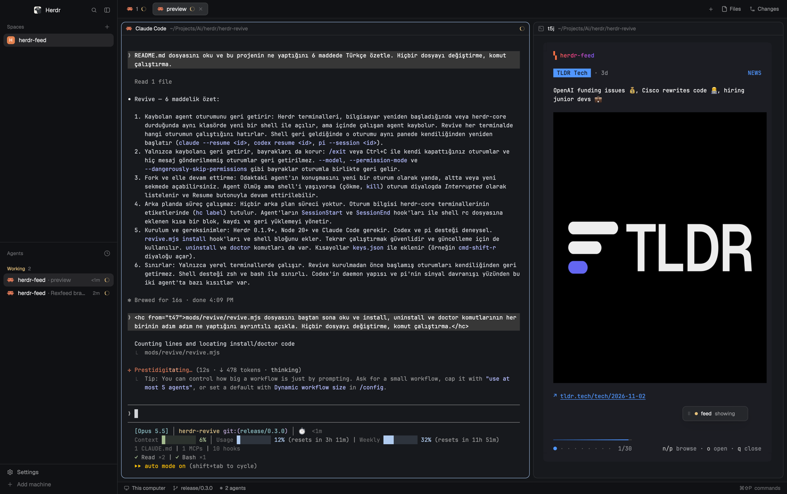

# herdr-feed

herdr-feed opens a pane of short tech cards beside the coding agent you're working with while it
works: news, tips, product launches, releases, YouTube and Reddit clips, with images and muted
video drawn in the pane. It opens when the focused agent starts working, pauses while you look at
it, and closes when the agent stops. A small switch window turns it on and off.

## Installing it (for the agent doing it)

The mod drives a program, `herdr-feed`, built from the Rust sources in this repository. Tell the
person before installing: the program reaches the network (public RSS and JSON feeds, the pages
they link to, YouTube through `yt-dlp`), runs `ffmpeg` and `yt-dlp`, writes under
`~/.cache/herdr-feed`, and edits the pane weights in herdr-core's `herdr-app` layout document to
size the feed. The mod itself runs only that program (`exec`) and app commands.

1. Read every file in this repository before copying anything.
2. Needs Rust (`cargo`), Python 3, and for images and video `ffmpeg` and `yt-dlp`
   (`brew install ffmpeg yt-dlp`). Say which are missing.
3. Build and link the program: `cargo build --release`, then
   `ln -sf "$PWD/target/release/herdr-feed" ~/.local/bin/herdr-feed`. The mod calls it at exactly
   that path.
4. Copy `mods/herdr-feed` to `~/.config/herdr-app/mods/herdr-feed` and run
   `herdr-app check ~/.config/herdr-app/mods/herdr-feed`. It must pass.
5. Merge `keys.json` into `~/.config/herdr-app/keys.json`. Ask the person first if `cmd-shift-e`
   or `cmd-alt-e` is already bound.
6. Run `~/.local/bin/herdr-feed fetch` once (about a minute; it prints a count per source and
   `videos N/M cached`).
7. Tell the person to press `cmd-shift-e`, then send their agent a prompt.

`./install.sh` does steps 3 to 6 in one go (the merge keeps keys already bound elsewhere and
backs `keys.json` up to `keys.json.bak-herdr-feed`); `./uninstall.sh` undoes them.

## What you see

- **The switch** (`mod.open:herdr-feed`): a window 150×34px, Herdr's default window frame, that
  stays where it's dropped and comes back on the next start until closed. One row, 10px side
  padding, 8px gaps, 12px text: a `⠿` grip in `dim`, then a 7px round dot, **feed** in semibold
  (`foreground`, or `muted` when off) and a state word in `muted`:
  - *off* (dot `dim`), *on* (dot `accent`), *showing* (dot `working`), *paused* (dot `idle`),
  - *no cards*, *not installed*, *could not open* (dot `blocked`).
- **The feed**: a terminal pane split to the right of the agent, 38% of the row. Inside, drawn by
  the program on a rounded card in the card's tint:
  - a `▚ herdr-feed` badge in an ember → magenta → violet gradient,
  - the source as a colored pill, its age (`2m`, `5d`), and the kind on the right (`NEWS`, `TIP`,
    `RELEASE`, `PRODUCT`, `▶ VIDEO`),
  - the title (bold, up to three lines), the body (paragraphs; code lines syntax-highlighted),
  - the picture or the playing clip, centered, as large as the space allows,
  - the link (`↗` and the address, underlined, an OSC 8 hyperlink),
  - a progress bar in the card's color, the position as dots and `n/30`, and on the right the keys
    spelled out as far as the width allows: `n next · p prev · space pause · o open · q close`,
    then `n/p browse · space pause · o open · q close`, `n/p browse · o open · q close`,
    `n/p browse · q close`, `q close`.
  - While paused the bar becomes `⏸ paused · resumes when you're back on the agent` (or
    `⏸ paused · space to resume` after `space`).
  - On first open, the FEED wordmark for about a second.

## How it behaves

- Only the agent whose own pane has focus gets a feed, and only one feed exists at a time.
- **working**, focused agent, switch on: the feed opens beside it. Focus stays on the agent.
- **idle**, **done** or **blocked** (the feed's agent): the feed closes.
- Focus moves to another agent: the feed closes, and opens beside that agent if it is working.
- Focus moves to a plain pane in the same tab: the feed keeps playing.
- Focus moves into the feed, or to another tab: the feed pauses; coming back resumes it.
- `q` in the feed, or the last unseen card shown: the feed closes and stays closed until that
  agent's next turn (it stops working once).
- Click on the switch's word or dot, or `cmd-alt-e`: off (an open feed closes) and on again. The
  grip and the rest of the window drag it.
- In the feed: `n` `→` `↓` `l` `j` next, `p` `←` `↑` `h` `k` previous, `space` pause, `o` /
  `enter` open the link in the browser, `q` / `esc` / `ctrl+c` close. A card stays 10s; a video
  plays up to 20s, muted.
- Cards come in batches of 30, round-robin across sources: video, image card, text card,
  repeating; a kind that runs out is filled by the others. Seen cards never come back. With the
  cache older than 45 minutes, opening the feed starts a background fetch.

## Built from

- `mods/herdr-feed/mod.json`: `place: "none"`, overlay `popup` 1×1. `mod.open` starts a launcher
  copy that calls `openOverlay({ mod: "herdr-feed", props: { controller: true }, kind: "window",
  key: "herdr-feed", keep: true, width: 150, height: 34 })` and closes itself. Only the copy with
  `props().controller` acts.
- `mods/herdr-feed/main.js`: the switch. `cx.timer.every(1000)` gathers `agents()`, `focused()`,
  `terminals()` and `panes()` and asks `decide()` what to do. Opening: `exec(bin, ["ready"])`
  (exit 0 when there are unseen cards), `exec(bin, ["state", "herdr-app", "running"])`, a
  re-check of focus, then `run("terminal.open", { argv: [bin, "pane", "--key", "herdr-app",
  "--driven"], place: "right" })`, `run("pane.focus", { terminal: agent })`, a wait for the
  terminal to appear, and `exec(bin, ["resize", agent, feed])`. Pausing:
  `exec(bin, ["state", "herdr-app", "paused" | "running"])`. Closing: `state … closed`, then
  `run("terminal.kill")` if it hasn't exited within 1.5s. On/off is `shared("herdr-feed.enabled")`;
  `nextCommand()` takes `toggle` (`herdr-feed.toggle` in `keys.json`). `close()` kills an open feed.
- `mods/herdr-feed/lib/core.js`: `findFeed(terminals)` (an argv `…/herdr-feed pane`),
  `canOpenBeside(agent, agents, focused)` and `decide(…)`, with no Herdr calls, tested by
  `test/core.test.js`.
- The program (`src/`, Rust): `fetch` (sources, `og:image`, tip repos, clip prefetch), `pane` (the
  card renderer: kitty graphics, frames from `ffmpeg`), `state`, `ready`, and `resize`, which
  talks to `hc connect` (`doc.get` / `doc.set` on `herdr-app`, versioned) and sets the two blocks'
  `size.weight` to 0.62 / 0.38 of their sum.
- Art: `assets/logo.svg`, `assets/wordmark.svg`; the badge and wordmark gradient
  `#ff7043 → #ff408c → #8c5cff`.

## Watch out

- In the desktop app, terminals report no focus events (`\e[?1004h` gets nothing) and have no
  `HERDR_PANE_ID`, so pausing on focus comes from the mod's `focused()`, not the terminal.
- Kitty images placed with a negative z-index are drawn under the card's cell background and never
  show: place static images at the default z. Video frames are unaffected.
- `terminal.open { place: "right" }` splits whatever pane has focus at that moment and always
  50/50; there is no command to size a split. The weights live in herdr-core's `herdr-app`
  document; a fresh split can take a moment to appear there. That document is the app's own format,
  not an API: anything unrecognized must be left alone.
- `terminal.open`'s `name` is not kept on the terminal; find the feed by its argv.
- The pane must only read its state file while the mod drives it (`--driven`); a pane writing it on
  start races the mod's `paused` / `closed`.
- Herdr's shipped layouts are read-only, so the mod runs as a kept window rather than a layout
  block. Closing the window stops it.
- Two fetches can overlap; partial clips (`*.part.mp4`) of another fetch must not be deleted.
- A video card joins a batch only once its clip is on disk and unseen; after many video cards in a
  row there may be none left until the next fetch, and the video slots fall back to other cards.

## Done when

- `herdr-app check ~/.config/herdr-app/mods/herdr-feed` passes; `make test` passes.
- `cmd-shift-e` shows the switch reading *on*; a prompt to the focused agent opens the feed to its
  right within about a second, focus still on the agent, and the switch reads *showing*.
- The feed takes about 38% of the row (`hc connect` → `doc.get herdr-app` shows weights 0.62 /
  0.38).
- With unseen clips cached (`herdr-feed fetch` prints `videos N/M cached`), the first card is a
  video that plays; the next cards show a picture, then text.
- Clicking into the feed shows `⏸ paused …` and the switch reads *paused*; clicking the agent
  resumes it.
- When the agent finishes, the feed closes and the agent's pane takes the whole row again.
- `q` closes the feed and it doesn't reopen until the agent's next prompt.
- Clicking the switch turns it *off*; the next prompt opens nothing.
